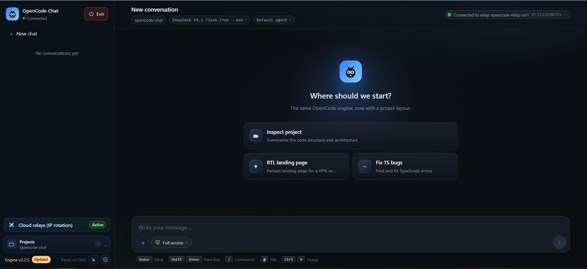

# OpenCode Chat

<p align="center">
  <a href="https://nodejs.org"></a>
  <a href="https://github.com/TSCSAM/opencode-chat/releases"></a>
  <a href="https://opencode.ai"></a>
  
</p>

<p align="center">
  
</p>

<p align="center">
  <b>A bilingual (English / Persian) web UI for the OpenCode engine</b><br>
  Telegram-style chat, agents, models, permissions, projects, a local 20-group tool hub,<br>
  custom providers, an image editor and three-way relay routing — all in your browser.
</p>

<p align="center">
  <b>English</b> · <a href="#فارسی">فارسی</a> · <a href="docs/README.md">Full documentation</a>
</p>

## Why OpenCode Chat?

The OpenCode terminal UI has no Unicode bidi handling, so Persian text is hard to read,
select and scroll. This project puts the same engine behind a fast, modern web interface
that supports both English (LTR) and Persian (RTL). Chat bubbles, Markdown with LTR code
blocks, complete session controls and settings live in the browser.

**English is the default language.** Use the `EN / فا` button at the bottom of the sidebar
or **Settings → General → Language** to switch. The choice is stored in `localStorage`
(`oc-lang`) and applied immediately, including `lang` and `dir` on the document.

## Highlights

- **Telegram-style chat** with message bubbles, Markdown, LTR code blocks, edit, queue,
  undo, compact, export and live token usage.
- **Projects and permission modes** — keep several workspace folders, switch between them,
  and choose **Plan / Ask / Auto / Full** per session.
- **Agents, models, providers and custom endpoints** — manage credentials, OAuth,
  environment variables, model limits and any OpenAI-, Anthropic- or Responses-compatible
  endpoint from Settings.
- **A local 20-group MCP tool hub** — files, documents, web/browser, images, media, data,
  SQLite, computer control, shell, code, Git/GitHub, DevOps, maps, SEO, messaging, memory,
  workflows and translation, registered with the engine automatically.
- **Images and files** — paste, drag and drop or attach any file; annotate images with
  point zoom, pan and drawing tools, then save the result back to the composer.
- **Three-way relay routing** — direct connection, cloud relays on Vercel, Netlify and
  Cloudflare, and regional Psiphon exits share one pool with a selectable primary route,
  automatic rotation and 429/error failover.
- **Bilingual, secure and self-contained** — English and Persian RTL everywhere; the engine
  token never reaches the browser; a local authenticated proxy enforces Host/Origin
  allowlists, CSP and body limits.

## What's new in v1.14.0

- **One routing policy for all three route types.** Choose automatic, direct, any enabled
  cloud relay or a specific tunnel region as the primary route; automatic rotation and
  failover live in the same panel.
- **The direct connection is a first-class route.** Its card stays visible above the cloud
  relays even when relays are active, reports the last HTTP status, and can be selected as
  primary or included in rotation/failover.
- **Per-region tunnel primary.** Every ready Psiphon region has **Select as primary** and
  shows the **Selected primary relay** pill when chosen.
- **Saving zero tunnel regions is allowed.** Save is enabled whenever the selection is
  dirty; saving an empty list stops active clients and clears a removed tunnel primary.
- **Failover works in both directions** between direct, cloud relays and tunnel regions,
  and a primary that is temporarily reconnecting is preserved while fallback routes serve
  the request.

See [`docs/CHANGELOG.md`](docs/CHANGELOG.md) for the full history since v1.1.0.

## Quick start

### From a release archive

Download the latest `opencode-chat-v1.14.0-source.zip` from
[Releases](https://github.com/TSCSAM/opencode-chat/releases/latest), extract it and run:

```text
Start OpenCode Chat.cmd
```

The first run installs dependencies inside `app/`, builds the frontend, starts the OpenCode
engine in the background and opens the browser. Later runs only need a double-click. Use
the red **Exit** button in the panel to stop the server and the engine together.

### From source

```bash
cd app
npm install
npm run build
npm run start
# → http://127.0.0.1:5178
```

Requirements: **Node.js 20+** (22.5+ recommended for the SQLite tool) and the OpenCode
engine (`npm install -g opencode-ai`).

## Project layout

```text
README.md                 ← GitHub landing page (repository only)
Start OpenCode Chat.cmd   ← double-click launcher (Windows)
app/                      ← frontend, local server, tests, tools, data and build
docs/                     ← README, CHANGELOG, LICENSE and screenshots
.github/                  ← CI and release workflows (repository only)
release/                  ← generated source archives (not shipped)
```

The release zip contains only `Start OpenCode Chat.cmd`, `app/` and `docs/`; caches,
`node_modules`, `dist`, logs and local provider data are never included.

## Documentation

- [Full README and Persian guide](docs/README.md)
- [Changelog](docs/CHANGELOG.md)
- [Third-party notices](app/THIRD_PARTY_NOTICES.md)
- [MIT License](docs/LICENSE) © TSCSAM

The bundled Psiphon tunnel client binaries are third-party software under GPL-3.0; see the
notices and `app/server/psiphon/LICENSE`.

---

<div dir="rtl" align="right">

## فارسی

**OpenCode Chat** یک رابط وب دوزبانه (انگلیسی / فارسی) برای موتور OpenCode است. زبان
پیش‌فرض انگلیسی است و با دکمهٔ `EN / فا` در پایین سایدبار یا از مسیر
**تنظیمات → عمومی → زبان** می‌توانید فارسی (RTL) را انتخاب کنید.

### نکات برجسته

- چت تلگرام‌مانند با Markdown، بلوک کد LTR، ویرایش پیام، صف، بازگردانی، فشرده‌سازی و
  خروجی Markdown
- مدیریت چند پروژه، حالت‌های مجوز Plan / Ask / Auto / Full و پیوست هر نوع فایل
- مدیریت ایجنت‌ها، مدل‌ها، پرووایدرها، کلیدها و endpointهای سازگار با OpenAI / Anthropic
- هاب محلی ۲۰ گروه ابزار MCP برای فایل، سند، وب، مرورگر، تصویر، داده، SQLite، شل،
  کد، Git، DevOps، نقشه، سئو، پیام‌رسان، حافظه، گردش‌کار و ترجمه
- ویرایشگر تصویر با زوم روی نقطهٔ دلخواه، جابه‌جایی و ذخیره در چت
- استخر مسیر مشترک برای **اتصال مستقیم**، **رله‌های ابری Vercel / Netlify / Cloudflare**
  و **تونل چندمنطقه‌ای Psiphon**؛ انتخاب مسیر اصلی (مستقیم، هر رله یا هر منطقهٔ تونل)،
  چرخش خودکار و جابه‌جایی روی خطای 429/5xx/شبکه بین هر سه
- رابط کامل RTL، امنیت پروکسی محلی و به‌روزرسانی موتور از داخل پنل

### شروع سریع

آخرین بستهٔ سورس را از صفحهٔ [Releases](https://github.com/TSCSAM/opencode-chat/releases/latest)
دانلود کنید، از حالت فشرده خارج کنید و `Start OpenCode Chat.cmd` را اجرا کنید. اولین اجرا
وابستگی‌ها را نصب، برنامه را بیلد و موتور را در پس‌زمینه اجرا می‌کند. برای خاموش‌کردن کامل،
از دکمهٔ **Exit** در پنل استفاده کنید.

از سورس:

```bash
cd app
npm install
npm run build
npm run start
# → http://127.0.0.1:5178
```

پیش‌نیازها: Node.js 20+ (برای ابزار SQLite، نسخهٔ 22.5+ توصیه می‌شود) و موتور OpenCode
(`npm install -g opencode-ai`).

### مستندات

- [راهنمای کامل فارسی و انگلیسی](docs/README.md)
- [تاریخچهٔ تغییرات](docs/CHANGELOG.md)
- [مجوز MIT](docs/LICENSE) © TSCSAM

</div>
