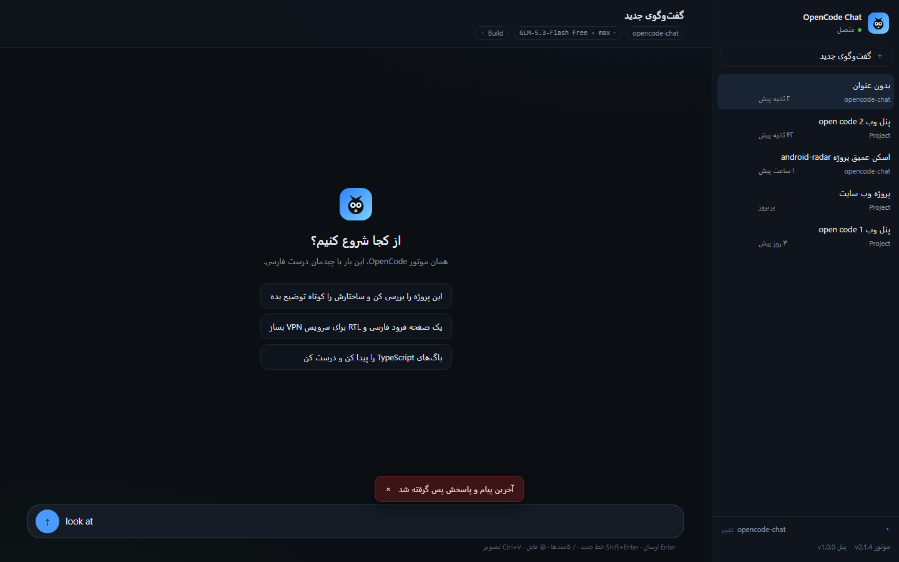

# OpenCode Chat

<p align="center">
  <a href="#پیش-نیازها"></a>
  <a href="#نسخه‌بندی-پنل-وب"></a>
  <a href="#پیش-نیازها"></a>
  
</p>

<p align="center">
  <b>رابط وب راست‌به‌چپ و فارسی برای موتور OpenCode</b><br>
  A beautiful, RTL-first web UI (Telegram-style) for the OpenCode engine — chats, agents, models,<br>
  permissions, file mentions, image pasting, token usage, config editor and engine updates.
</p>

<p align="center">
  
</p>

## چرا OpenCode Chat؟

ترمینال الگوریتم دوجهته‌ی یونیکد (bidi) ندارد؛ متن فارسی در TUI راست‌به‌چپ رندر
نمی‌شود و اسکرول و انتخاب آن دردسر دارد. این پروژه همان موتور OpenCode را با یک
وب‌اپِ فارسی و RTL درمی‌آورد: حباب‌چت تلگرام‌مانند، رندر مارک‌داون با بلاک کد
LTR، کنترل کامل جلسه‌ها و تنظیمات — همه در مرورگر.

## ویژگی‌ها (Features)

| | |
|---|---|
| 💬 **چت RTL تلگرام‌مانند** | حباب‌های پیام، گروه‌بندی نوبت‌ها، رندر Markdown + کد LTR |
| 🤖 **ایجنت‌ها و مدل‌ها** | انتخاب/ساخت ایجنت (build/plan…)، انتخاب مدل و مدلِ پیش‌فرض |
| 🗂️ **جلسه‌ها** | ساخت، جابه‌جایی، تغییر نام، حذفِ تأییددار، صف‌کردن پیام وقتی ایجنت مشغول است |
| 📜 **تاریخچه** | بارگذاری پیام‌های قدیمی‌تر (صفحه‌بندی زنده) |
| ❓ **سؤال تعاملی** | وقتی ایجنت از کاربر چندگزینه‌ای می‌پرسد، فرم تعاملی بالای کادر باز می‌شود (کلیک گزینه، پاسخ دستی، رد کردن) |
| ⏪ **Undo پیام** | پس‌گرفتن آخرین پیام و پاسخش با یک دستور |
| 📋 **Export** | کپی کل گفت‌وگو به کلیپ‌بورد (Markdown) یا دانلود فایل `.md` |
| ⚡ **کامندهای `/`** | منوی شناور با فیلتر زنده: `/new` `/sessions` `/model` `/agent` `/compact` `/undo` `/export` `/interrupt` `/settings` `/update` + کامندها و مهارت‌های موتور |
| 🗜️ **فشرده‌سازی زمینه** | `/compact` با حبابِ زنده‌ی پیشرفت و خلاصه‌ی استریم‌شونده |
| 📎 **چیپ‌های هوشمند** | کارت هر ابزار (ترمینال/نوشتن فایل/…) با سرنخِ مناسب، باز کردن جزئیات، مجوزها با اجازه‌ی همیشگی |
| 🖼️ **تصویر و فایل** | Ctrl+V یا کشیدن تصویر؛ منشن فایل با `@` (جست‌وجوی زنده‌ی فایل پروژه) |
| 📊 **مصرف زمینه** | چیپ درصد و تفکیک توکن‌ها (ورودی/کش/خروجی) به‌همراه هزینه |
| ⚙️ **تنظیمات OpenCode** | ادیتور کامل `opencode.jsonc` (مجوزها، MCP، افزونه‌ها، پیشرفته) — بدون تم و کیبایند که وب خودش دارد |
| 🛡️ **امنیت** | توکن موتور هرگز به مرورگر نمی‌رسد؛ همه‌چیز از سرورِ محلی پروکسی می‌شود |
| 🔄 **به‌روزرسانی موتور** | نشانگر «آپدیت!» + نصب رسمی با استریم خروجی + ری‌استارت سرویس |
| 📦 **نسخه‌بندی** | نسخهٔ پنل (`v1.0.0`) در سایدبار دیده می‌شود |

## پیش‌نیازها (Prerequisites)

- **Node.js 20+** (برای اجرای سرور و بیلد) — [nodejs.org](https://nodejs.org)
- **موتور OpenCode** — `npm install -g opencode-ai`
- مرورگر مدرن (Chrome/Edge/Firefox — Chrome برای تست‌های خودکار)
- ویندوز ۱۰/۱۱ برای دابل‌کلیک لانچر؛ در لینوکس/مک: `npm run start`

## شروع سریع (Quick Start)

**راه ۱ — پوشه‌ی قابل‌حمل:**
همه‌چیز داخل فایل ریلیز (`opencode-chat.zip`) آماده است؛ بازش کن، دابل‌کلیک:

```
Start OpenCode Chat.cmd
```

اولین اجرا وابستگی‌ها را نصب و برنامه را بیلد می‌کند، موتور OpenCode را در
پس‌زمینه بالا می‌آورد و مرورگر را باز می‌کند. از این به بعد فقط یک دابل‌کلیک —
بعد از خاموش/روشن سیستم هم نیازی به اجرای دستی چیزی نیست.

**راه ۲ — از سورس:**

```bash
npm install
npm run build
npm run start
# → http://127.0.0.1:5178
```

**راه ۳ — توسعه:**

```bash
npm run dev     # سرور + vite dev با هات‌ریلود
```

## آزمون‌ها

- `npm run smoke` — رفت‌وبرگشت کامل با مدل واقعی و رندر بلاک کد
- `npm run e2e` — ۱۰ مرحله‌ی کامل رابط (کامندها، صف، undo/export، منشن `@`، آپلود تصویر، فرم سؤال…)

هر دو با Chrome headless (قابل تغییر با متغیر `CHROME_PATH`).

## معماری

```
مرورگر  ──/oc/api/*──▶  server.mjs  ──(Authorization)──▶  OpenCode engine
```

| فایل | کار |
| --- | --- |
| `server.mjs` | پروکسی احراز هویت‌شده + سرو اپ + آپلود تصویر + نوشتن تنظیمات + آپدیت/ری‌استارت موتور |
| `src/App.tsx` | وضعیت، رویدادهای زنده، ارسال، تأییدها، کامندهای `/` |
| `src/Composer.tsx` | کادر ارسال: منوی `/`، منشن `@`، پیوست تصویر، صف |
| `src/Settings.tsx` | پنل تنظیمات OpenCode |
| `src/Update.tsx` | پنل به‌روزرسانی موتور |
| `src/Sidebar.tsx` | جلسه‌ها، تغییر پوشه، نسخه‌ها |
| `src/reduce.ts` | کاهش‌گر رویدادهای `session.*` به پیام‌ها |
| `src/QuestionCard.tsx` | فرم سؤال تعاملی موتور |

## نسخه‌بندی پنل وب

نسخه در `package.json` تعریف می‌شود و در فوتر سایدبار (کنار نسخه‌ی موتور)
نمایش داده می‌شود: `v1.0.1` اصلاح کوچک، `v1.1.0` قابلیت تازه، `v2.0.0` تغییر
بزرگ. بعد از تغییر، فقط `npm run build`.

## محدودیت‌های فعلی

- پیام‌های قدیمی‌ترِ بارگذاری‌شده از `/session/context` فقط متنی رندر می‌شوند (بدون کارت ابزار)
- تم و کیبایند موتور در وب پنل ندارند (عمداً — این اپ تم خودش را دارد)
- رندر PDF/word یا ترمینال PTY مرئی داخل چت پشتیبانی نمی‌شود

## عیب‌یابی سریع

- «موتور وصل نشد» → `npm install -g opencode-ai` بعد اجرای مجدد لانچر
- پورت اشغال → `set PORT=5179` قبل از اجرا
- بیلد قدیمی مرئی است → `Ctrl+R` (اسونس از دیسک سروش می‌شود)
- کنسول سرور (پنجره سیاه) پیام‌های راهنمای فارسی چاپ می‌کند — متنش را بفرست

---

⭐ اگر به کارت آماده کرد، استاره بده — «OpenCode web UI | رابط وب فارسی برای OpenCode»
