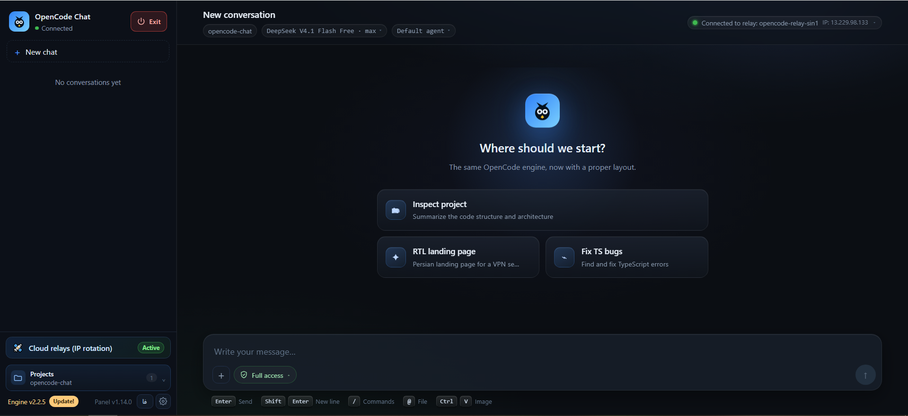

# OpenCode Chat

<p align="center">
  <a href="https://nodejs.org"></a>
  <a href="https://github.com/TSCSAM/opencode-chat/releases"></a>
  <a href="https://opencode.ai"></a>
  
</p>

<p align="center">
  <b>A bilingual (English / Persian) web UI for the OpenCode engine</b><br>
  Telegram-style chat, agents, models, permissions, file mentions, image paste, token usage,<br>
  a full config editor, a 20-group local tool hub, relay management and engine updates — all in your browser.
</p>

<p align="center">
  <b>English</b> · <a href="#فارسی">فارسی</a>
</p>

<p align="center">
  
</p>

## Why OpenCode Chat?

The OpenCode terminal UI has no Unicode bidi handling, so Persian text is hard to read,
select and scroll. This project puts the same engine behind a fast, modern web interface
that supports both English (LTR) and Persian (RTL). Chat bubbles, Markdown with LTR code
blocks, complete session controls and settings live in the browser.

**English is the default language.** Use the `EN / فا` button at the bottom of the sidebar
or **Settings → General → Language** to switch. The choice is saved in `localStorage`
(`oc-lang`) and applied immediately, including `lang` and `dir` on the document.

## Features

| Feature | Description |
|---|---|
| 💬 **Telegram-style chat** | Message bubbles, turn grouping, Markdown rendering and LTR code blocks |
| 🌐 **Bilingual UI** | English (default) and Persian RTL; server responses follow the selected language |
| ✏️ **Edit the last message** | Edit in place while keeping attachments; restore the original if resending fails |
| 🤖 **Agents and models** | Pick or create agents (build/plan/…), choose models, set defaults, live model sync |
| 🔌 **Providers and integrations** | API keys, OAuth, environment variables, external login and commands; enable or remove credentials |
| 🗂️ **Sessions** | Create, switch, rename and safely delete sessions; queue messages while the agent is busy |
| 📁 **Projects** | Multi-folder workspace manager: browse the filesystem, add one or several project folders, switch between them, and keep the list across restarts |
| 🛡️ **Permission modes** | Plan / Ask / Auto / Full picker in the composer, applied per session on the engine for native actions and tool-hub calls alike |
| ⏳ **Queued follow-ups** | Pending messages appear above the composer; they send automatically after the current run, or immediately with **Send now** |
| 📜 **History** | Load older messages with live pagination |
| ❓ **Interactive questions** | Multiple-choice question forms from the agent, with a custom answer option |
| ⏪ **Undo / compact** | Revert the last turn or compact the context with streaming progress |
| 📋 **Export** | Copy the conversation as Markdown or download a `.md` file |
| ⚡ **Slash commands** | `/new`, `/sessions`, `/model`, `/agent`, `/compact`, `/undo`, `/export`, `/interrupt`, `/settings`, `/update` plus engine commands and skills |
| 📎 **Tools and permissions** | Tool cards for terminal/file operations with details and “always allow” permissions |
| 🧰 **Local tool hub (20 MCP tools)** | Files, documents, web/browser, images, media, data/SQLite, computer control, shell, code/git/devops, maps, SEO, messaging, memory, workflow and translation; auto-registered in OpenCode and called by the model without manual invocation |
| 🖼️ **Images and files** | Attach images, PDFs, text or archives with the **+** button, paste images with Ctrl+V or drag and drop; mention files with `@` and live search |
| 🎨 **Image editor with zoom** | Click any message image or attachment to annotate it. Zoom toward a point with the wheel, pinch or **+/−/Fit**, pan with the hand tool, Space-drag, middle-drag or Alt-drag, then save back to the composer |
| 📊 **Context usage** | Context percentage plus input, cache and output token breakdown with cost |
| 🧠 **Model limits** | Curated `model-limits.json` catalog, sync into `opencode.json`, and a settings tab for review |
| ⚙️ **OpenCode settings** | Full `opencode.jsonc` editor (permissions, MCP, plugins, advanced) minus theme/keybinds |
| 🛡️ **Security** | Engine token never reaches the browser; local proxy with Host/Origin allowlists, CSP, nosniff, body limits |
| 🔁 **Relays** | Opt-in Vercel, Netlify and Cloudflare relay deployment plus a local multi-region Psiphon tunnel. Direct, cloud relays and tunnel regions share one route pool with a selectable primary route, automatic rotation and 429/error failover across all three; every tunnel region can be tested and selected as primary |
| 🔄 **Engine updates** | Check npm, show the latest version, install and restart with streamed output |
| 🚪 **Exit from the panel** | Prominent red power button stops the hidden server and the OpenCode engine in one click, with no console window left open |
| 📦 **Versioning** | Panel version in the sidebar footer next to the settings button |

## Requirements

- **Node.js 20+** (Node.js 22.5+ is recommended; the SQLite tool uses the built-in
  `node:sqlite` module)
- **OpenCode engine** — `npm install -g opencode-ai`
- A modern browser (Chrome, Edge or Firefox; automated tests need Chrome)
- Windows 10/11 for the double-click launcher; `npm run start` on Linux and macOS

## Project layout

The launcher and README are the only files at the top level; everything else lives in a folder:

```text
README.md                 ← GitHub landing page (repository only)
Start OpenCode Chat.cmd   ← double-click launcher (Windows)
app/                      ← frontend, local server, tests, tools, data and build
  src/                    ← App, main and env types
    components/           ← chat UI, settings, editor, sidebar, pickers
    lib/                  ← API client, events, reducers, i18n, types
    styles/               ← styles.css
  server/                 ← authenticated local proxy, relay management and tool registration
  server/mcp/             ← bundled local MCP tool hub (tools, libraries and registry)
  server/relays/          ← bundled relay templates
  server/psiphon/         ← official Psiphon client binaries, signed server list and license
  data/                   ← model-limits.json and the generated tool catalog
  scripts/                ← build helpers (tool catalog generation)
  tests/                  ← smoke, MCP and end-to-end scripts
  tools/                  ← launcher, build check, watchdog and release packager
  dist/                   ← generated production bundle (not in source archives)
docs/                     ← README, CHANGELOG, LICENSE and screenshots (repository only)
release/                  ← generated source archives (not in source archives)
.github/                  ← CI and release workflows (repository only)
```

The release zip contains only `Start OpenCode Chat.cmd`, `LICENSE` and `app/`.
Documentation and screenshots stay in this repository, and repository-only files such as
`.github/` workflows are not shipped to users.

## Quick Start

### 1. From a release archive

Download `opencode-chat-v1.14.0-source.zip` from the
[Releases](https://github.com/TSCSAM/opencode-chat/releases) page, extract it and run:

```text
Start OpenCode Chat.cmd
```

The archive contains source only (no `node_modules`, `dist`, caches, screenshots or
documentation) and keeps the launcher and `app/` layout shown above. On first run the
launcher installs dependencies inside `app/`,
builds the app, starts the OpenCode engine in the background and opens the browser. The
console window closes automatically once the app is ready. Use the **Exit** button at the
top of the panel to stop the server and the OpenCode engine together. Later runs only need
a double-click. The release workflow builds this archive with `npm run release:pack` from
the `app/` folder, so the GitHub asset stays small.

### 2. From source

```bash
cd app
npm install
npm run build
npm run start
# → http://127.0.0.1:5178
```

The app opens with the project folder (the parent of `app/`) as its default workspace.
Pass `--dir="D:\path\to\project"` to point new chats somewhere else.

### 3. Development

```bash
cd app
npm run dev     # server + Vite dev mode with hot reload
```

## Language

- Default: English (`lang="en"`, `dir="ltr"`).
- Persian: `lang="fa"`, `dir="rtl"`, Persian font stack, logical alignment and RTL-aware
  code blocks.
- The translation layer is dependency-free: English strings are the keys and Persian
  entries live in `app/src/lib/i18n.tsx`. A missing key falls back to English.
- Server error messages honor the `accept-language` header sent by the client.

## Tests

```bash
cd app
npm run smoke   # full round-trip with a real model and code-block rendering
npm run e2e     # 10-step UI walkthrough: commands, queue, undo/export, @mentions, uploads, question form
node tests/mcp-smoke.mjs    # starts the MCP hub directly and calls system info
node tests/mcp-session.mjs  # browser session: navigate, evaluate, screenshot, image info, performance
node tests/mcp-db.mjs       # SQLite query through the database tool
node tests/mcp-agent.mjs    # asks a real model to call catalog/files without naming an invocation UI
node tests/mcp-natural.mjs  # natural prompt: the model must choose the browser tool itself
node tests/mcp-tools-ui.mjs # Settings → Tools panel, status and reconnect button
```

The UI tests use headless Chrome on `http://127.0.0.1:5178`; set `CHROME_PATH` if Chrome
is installed elsewhere. Start the app before running them.

## Bundled local tools

The app ships a local [Model Context Protocol](https://modelcontextprotocol.io/) server
in `app/server/mcp/`. At startup it is merged into the user's OpenCode config as
`opencode-chat-tools`, with `codemode: false` so its tools stay on the model's native tool
list instead of being hidden behind Code Mode. A permission rule allows the
`opencode-chat-tools_*` actions. The model can therefore call any of the 20 tool groups
directly when a task needs them; no slash command, prompt prefix or manual invocation is
required. Existing MCP servers, permissions and JSONC comments are preserved.

Open **Settings → Tools** to see the connection status, the config path, every tool and
its actions, and to refresh or reconnect the server. The same data is available at
`GET /app/tools`; `POST /app/tools/register` re-registers and reconnects it.

| Tool | What it covers |
|---|---|
| `files` | Read/write/edit/copy/move, trees, recursive search, hashes, duplicate detection |
| `documents` | PDF, DOCX, XLSX, PPTX, Markdown, HTML and ZIP create/read/convert |
| `web` | Search, fetch, crawl, HTTP, metadata, tables, sitemap/robots, research |
| `browser` | Chrome automation, screenshots, forms, uploads, downloads, performance, accessibility |
| `images` | Resize/crop/rotate/filters/watermark/annotate/compare, OCR, optional generation |
| `data` | CSV/JSON, statistics, correlation, regression, forecast, SVG charts |
| `database` | SQLite query/exec/migrate/tables/import/export/backup |
| `media` | Video/audio conversion, trim, frames, GIF, subtitles, TTS, optional STT/video |
| `memory` | Persistent searchable notes and context |
| `system` | Processes, services, windows, screenshots, clipboard, mouse/keyboard, UI Automation |
| `shell` | Terminal, PowerShell, cmd, Python, Node, npm and background processes |
| `code` | Project map, symbols, dependencies, security scan, tests/build/lint/typecheck |
| `git` | Git CLI and GitHub API (needs Git / `GITHUB_TOKEN` for some actions) |
| `devops` | SSH/SCP, DNS, TLS, ports, Docker and Kubernetes wrappers |
| `maps` | Geocoding, routes, nearby places, weather, time zones and Leaflet maps |
| `seo` | Audits, keywords, SERP, Core Web Vitals and broken links |
| `comms` | Email, Slack, Discord, Telegram, webhooks, SMS, notifications and ICS calendar |
| `workflow` | Persistent tasks, plans, sequential/parallel tool chains and schedules |
| `translate` | LibreTranslate or MyMemory translation and language detection |
| `catalog` | Lists every local capability and checks runtime requirements |

Everything that can run locally works without an API key. Optional connectors read
configuration from the environment (for example `GITHUB_TOKEN`, `SMTP_HOST`,
`SLACK_WEBHOOK_URL`, `TELEGRAM_BOT_TOKEN`, `OPENCODE_CHAT_IMAGE_API_KEY`,
`OPENCODE_CHAT_STT_API_KEY`, `OPENCODE_CHAT_VIDEO_API_KEY`, `LIBRETRANSLATE_URL`).
When a connector is not configured the tool returns a clear configuration message
instead of pretending to succeed.

## Architecture

```text
browser  ──/oc/api/*──▶  app/server/server.mjs  ──(Authorization)──▶  OpenCode engine
```

| File | Responsibility |
|---|---|
| `app/server/server.mjs` | Authenticated proxy, app serving, image upload, config writes, engine updates and restarts |
| `app/server/tooling.mjs` | Registers/reconnects the bundled MCP server without disturbing other config |
| `app/server/mcp/index.mjs` | Local stdio MCP entry point and lifecycle |
| `app/server/mcp/tools/` | The 20 tool groups exposed to the model |
| `app/server/mcp/lib/` | Shared filesystem, HTTP, browser, office, media, data and automation helpers |
| `app/server/relay-manager.mjs` | Unified direct/cloud-relay/tunnel route pool, primary selection, rotation, failover and relay deployment |
| `app/server/psiphon-manager.mjs` | Local tunnel clients, per-region SOCKS routes, exit learning, pre-connect region probes, renewal limits and persistence |
| `app/src/App.tsx` | State, live events, sending, permissions and slash commands |
| `app/src/components/Composer.tsx` | Composer: slash menu, `@` mentions, image attachments and queue |
| `app/src/components/ImageEditor.tsx` | Canvas annotation editor with point zoom, pan, touch gestures and export |
| `app/src/components/Settings.tsx` | OpenCode settings panel, including language, MCP and the local Tools tab |
| `app/src/components/Providers.tsx` | Providers, integrations and engine credentials |
| `app/src/components/LimitsPanel.tsx` | Model-limits tab, catalog comparison and apply action |
| `app/src/components/CustomProviders.tsx` | Custom provider list, endpoint/API-format editor, model fetch and enable/disable |
| `app/src/components/Relays.tsx` | Relay deployment, direct route card, primary route selector, rotation policy, testing and routing UI |
| `app/src/components/PsiphonTunnelPanel.tsx` | Local tunnel region picker with pre-connect tests, per-region primary selection, routing mode, live exit status and tests |
| `app/src/components/Update.tsx` | Engine update panel |
| `app/src/components/Sidebar.tsx` | Sessions, workspace switching, versions and language toggle |
| `app/src/lib/i18n.tsx` | Translation dictionary, provider and language persistence |
| `app/src/lib/reduce.ts` | Reduces `session.*` events into messages |
| `app/src/lib/api.ts` | Browser-side API helpers |
| `app/src/components/QuestionCard.tsx` | Interactive question form |
| `app/data/model-limits.json` | Verified context/output limits catalog |
| `app/data/custom-providers.json` | Local custom-provider definitions (created on first save; never packaged) |

## Versioning

The panel version comes from `app/package.json` and is shown in the sidebar footer. Use
`1.13.1` for fixes, `1.14.0` for features and `2.0.0` for breaking changes. After changing the
version, run `cd app && npm run build`. Full history: [`CHANGELOG.md`](CHANGELOG.md).

## Limitations

- Older messages loaded from `/session/context` render as plain text (no tool cards).
- Engine themes and keybinds are not exposed; this UI has its own.
- PDF/Word rendering and an in-chat PTY terminal are not supported.
- The tool hub is local-first. Actions that need a third-party account or an external
  provider (email/SMTP, Slack, Telegram, GitHub, paid image/video/STT models, Docker,
  Kubernetes, SSH, Git) report a clear configuration error when that dependency is not
  installed or configured. Git, Docker and Kubernetes are not bundled.
- OCR, computer control and shell actions are Windows-first; the rest of the hub is
  cross-platform where the underlying runtime allows it.
- The SQLite tool needs Node.js 22.5+ (`node:sqlite`). On older Node versions it returns
  a clear version message; the other tools keep working.
- The local tunnel route needs the bundled official client, so it is available on Windows
  (x86/x64) and Linux x86-64 only; there is no Linux arm64 build. It also needs a direct
  internet connection that can reach the tunnel network. See `app/THIRD_PARTY_NOTICES.md`
  for the client's license and source.

## Troubleshooting

- **Engine not connected** → run `npm install -g opencode-ai`, then restart the launcher.
- **Port in use** → the app automatically moves to the next free port and prints the new
  address in the console. You can also set `PORT` manually.
- **Seeing an old build** → press `Ctrl+R`. The launcher rebuilds when files in `app/src/`
  are newer than `app/dist/`.
- **Server console** → send the messages printed there when reporting a problem.
- **The model does not see the local tools** → open **Settings → Tools**, check that the
  status is **Connected**, then press **Reconnect**. This forces a fresh MCP handshake so
  the current `codemode: false` catalog reaches the model. The same server is visible in
  `opencode mcp list` as `opencode-chat-tools`.

## License

[MIT](LICENSE) © TSCSAM

The bundled Psiphon tunnel client binaries are third-party software under
GPL-3.0; see [`app/THIRD_PARTY_NOTICES.md`](../app/THIRD_PARTY_NOTICES.md) and
`app/server/psiphon/LICENSE`.

---

<div dir="rtl" align="right">

## فارسی

**OpenCode Chat** یک رابط وب دوزبانه (انگلیسی / فارسی) برای موتور OpenCode است. زبان
پیش‌فرض **انگلیسی** است و با دکمهٔ `EN / فا` در پایین سایدبار یا از مسیر
**تنظیمات → عمومی → زبان** می‌توانید فارسی (RTL) را انتخاب کنید. انتخاب شما در
`localStorage` با کلید `oc-lang` ذخیره می‌شود.

### چرا این پروژه؟

ترمینال OpenCode الگوریتم دوجهتهٔ یونیکد ندارد و متن فارسی در آن خواندن، انتخاب و
اسکرول سختی دارد. این پروژه همان موتور را در قالب یک وب‌اپ سریع و مدرن ارائه می‌دهد:
چت حبابی تلگرام‌مانند، رندر Markdown با بلوک کد LTR، کنترل کامل جلسه‌ها، ایجنت‌ها،
مدل‌ها، پرووایدرها، رله‌ها، تنظیمات و به‌روزرسانی موتور.

### قابلیت‌ها

- چت دوزبانه با پشتیبانی کامل RTL و فونت مناسب فارسی
- ویرایش آخرین پیام، صف پیام، بازگردانی پیام و فشرده‌سازی زمینه
- انتخاب ایجنت و مدل، همگام‌سازی زندهٔ مدل‌ها و ظرفیت واقعی آن‌ها
- مدیریت پرووایدرها، Integrationها و credentialها
- جلسه‌ها، تاریخچه، سؤال تعاملی، خروجی Markdown و دستورهای `/`
- پیوست تصویر با Ctrl+V، منشن فایل با `@` و کارت ابزارها با مجوز «همیشه اجازه بده»
- ویرایشگر تصویر با زوم روی نقطهٔ دلخواه (چرخ ماوس، پینچ یا دکمه‌های +/−/Fit)،
  جابه‌جایی با ابزار دست یا نگه‌داشتن Space، و ذخیرهٔ نتیجه در چت
- مدیریت رله‌های Vercel، Netlify و Cloudflare با جابه‌جایی خودکار روی خطای 429
- استخر مسیر مشترک برای اتصال مستقیم، رله‌های ابری و تونل Psiphon؛ انتخاب مسیر اصلی (مستقیم، هر رله یا هر منطقهٔ تونل) و چرخش/جابه‌جایی خودکار بین هر سه
- تونل محلی چندمنطقه‌ای با کلاینت رسمی Psiphon: هر منطقه پروکسی SOCKS و IP خروجی جداگانه دارد،
  تست اتصال هر منطقه پیش از فعال‌سازی انجام می‌شود، هر منطقه را می‌توان به‌عنوان مسیر اصلی انتخاب کرد، آدرس‌های مصرف‌شده کنار گذاشته می‌شوند و هر منطقه حداکثر سه بار در ساعت آدرس تازه می‌گیرد
- تنظیمات کامل `opencode.jsonc` و به‌روزرسانی موتور از npm
- امنیت: توکن موتور هرگز به مرورگر نمی‌رسد؛ پروکسی محلی با allowlist، CSP و محدودیت حجم

### پیش‌نیازها

- Node.js 20+ (برای ابزار SQLite، Node.js 22.5+ توصیه می‌شود)
- موتور OpenCode: `npm install -g opencode-ai`
- مرورگر مدرن (برای تست‌های خودکار Chrome لازم است)

### ساختار پوشه‌ها

تنها فایل‌های ریشه، لانچر ویندوز و README هستند؛ بقیهٔ اجزا در پوشه‌های جدا قرار دارند:

```text
README.md                 ← صفحهٔ معرفی در گیت‌هاب (فقط در مخزن)
Start OpenCode Chat.cmd   ← لانچر
app/                      ← فرانت‌اند، سرور محلی، تست‌ها، ابزارها، داده و بیلد
docs/                     ← README، CHANGELOG، LICENSE و تصاویر (فقط در مخزن)
release/                  ← آرشیوهای ساخته‌شده
.github/                  ← ورک‌فلوهای CI و انتشار (فقط در مخزن)
```

فایل زیپ انتشار فقط شامل `Start OpenCode Chat.cmd`، فایل `LICENSE` و پوشهٔ `app` است.
مستندات و تصاویر در مخزن گیت‌هاب می‌مانند و فایل‌های مخصوص مخزن مثل ورک‌فلوهای
`.github` داخل زیپ کاربران قرار نمی‌گیرند.

### شروع سریع

از سورس:

```bash
cd app
npm install
npm run build
npm run start
# → http://127.0.0.1:5178
```

یا در ویندوز فایل `Start OpenCode Chat.cmd` را در ریشهٔ پروژه دابل‌کلیک کنید. بستهٔ ریلیز
فقط سورس تمیز و سبک است (بدون `node_modules` و `dist`)؛ اولین اجرا فایل‌های مورد نیاز
را داخل `app/` دانلود می‌کند، برنامه را بیلد می‌کند و موتور را در پس‌زمینه اجرا می‌کند.
پس از آماده‌شدن برنامه، پنجرهٔ CMD خودکار بسته می‌شود. برای خاموش‌کردن کامل سرور و
هستهٔ OpenCode از دکمهٔ **Exit** در بالای پنل استفاده کنید. برای ساخت دوبارهٔ همین بسته
از داخل `app/` دستور `npm run release:pack` را اجرا کنید.

### آزمون‌ها

```bash
cd app
npm run smoke
npm run e2e
```

هر دو به Chrome headless و سرور در حال اجرا روی پورت ۵۱۷۸ نیاز دارند. مسیر Chrome را
می‌توانید با `CHROME_PATH` تغییر دهید.

### مجوز

[MIT](LICENSE) © TSCSAM

</div>
